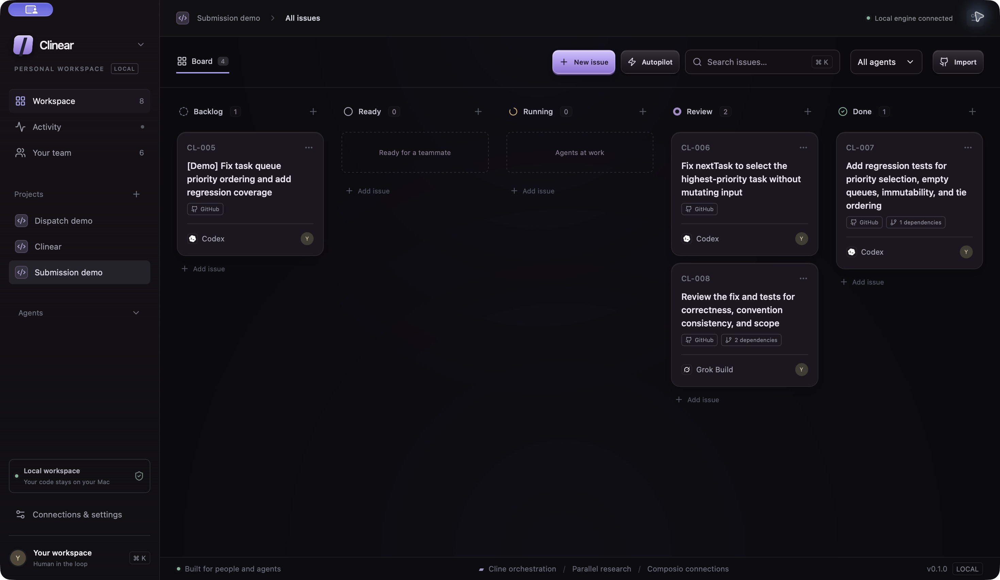
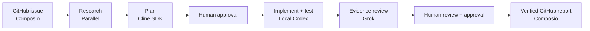

<div align="center">

# Clinear

### Your local AI team. One shared work queue.

[](LICENSE)


**Cline + Linear → an agentic kanban for solo developers.**

Clinear turns a GitHub issue into reviewed work—with your local AI team.<br />
**You direct the work. Agents execute. You decide what ships.**

[See the demo](#demo-an-urgent-task-runs-last) · [Run locally](#run-on-macos) · [Submission evidence](docs/submission/README.md) · [MIT license](LICENSE)

</div>

[](docs/submission/assets/clinear-board.png)

<p align="center"><sub>Actual macOS app · fresh CL-005–008 submission run · click for the original 2940 × 1706 capture.<br />Cards organize work; dragging a card does not execute an agent.</sub></p>

---

## Less context copying. More finished work.

A small bug can mean a browser full of research, several agent terminals, a test log, and a GitHub update. Clinear brings that handoff into **one card**: the goal, evidence, plan, assigned agent, live activity, diff, feedback, and approved report stay together.

The name combines **Cline**, the planning and knowledge-work engine, with the focused issue-tracking experience that inspired **Linear**. Clinear is an independent open-source project, not an official Linear integration.

- **Delegate a clear outcome.** Cline proposes tasks, acceptance criteria, dependencies, and a suitable agent. Edit the plan before accepting it.
- **Match the model to the task.** Assign a research synthesis, analysis, or document draft to the Cline SDK worker and choose a model ID per card. Its actual written deliverable stays with the execution record.
- **Work with the tools on your Mac.** Codex implements and tests in a Git worktree. Grok reviews the resulting diff and recorded evidence. Claude Code is optional.
- **Review results in context.** Inspect sources, execution history, changes, and test output without reconstructing the conversation across tools.
- **Choose what happens next.** Run individual tasks or authorize a bounded Autopilot batch. Publication always requires an explicit approval.
- **Discover the next useful task.** Optional recurring research adds source-backed proposals to the backlog while the app is open.

## Three integrations, distinct jobs

| Integration | What it contributes to Clinear | What you can inspect |
| --- | --- | --- |
| **Cline SDK** | Plans tasks, checks readiness, discovers opportunities, and executes knowledge-work cards with a per-card model ID. Configurable providers include Cline-hosted inference, Anthropic, and the local Codex adapter. | Editable plans, readiness questions, discovery rationale, and completed analysis or document drafts. |
| **Parallel** | Finds supporting documentation and research for the current issue or the next backlog opportunity. | Source URLs and excerpts attached to the work. |
| **Composio** | Connects your GitHub account, imports issues, publishes approved reports, and reads comments back to verify delivery. | The original issue, the outgoing draft, and the resulting GitHub comment. |

Cline handles reasoning; **Clinear's scheduler** handles dependency order, execution budgets, worktree locks, and local CLI dispatch. Configurable providers do not mean multiple models run simultaneously or that every upstream Cline feature is exposed by this MVP.



**Backlog → Ready → Running → Review → Done.** Moving a card does not start an agent. Successful execution stops in Review; an approved, verified publication completes the issue workflow. The code remains on a local branch—Clinear does not create or merge a pull request.

## Run on macOS

Requirements: Node.js **22+**, npm, Rust, Xcode Command Line Tools, Git, and a signed-in **Codex CLI**. Grok Build is needed for the review stage. Claude Code remains an optional connector; it is not required or assigned work by default.

```sh
npm ci
npm run desktop
```

The development server binds only to `127.0.0.1:1437`. `npm run dev` alone opens a **read-only UI preview**: local execution only works inside Tauri. `npm run bundle` creates `src-tauri/target/release/bundle/macos/Clinear.app` for the current Mac architecture. The bundle includes JavaScript dependencies but requires an existing Node 22+ installation and local CLI executables; it is not signed or notarized. Set `CLINEAR_NODE` when launching from a terminal if Node cannot be located automatically.

## First run

1. Open **Connections & settings**. Verify the executable paths for Codex and Grok, then **Test** their real connections. A detected binary is not proof of successful authentication.
2. Select **Cline + local Codex login** for planning without another API key, or select a Cline/Anthropic provider and configure its key and model ID. Cline's real agent loop calls a read-only Codex model adapter in local mode; it does not pretend to use Cline-hosted inference.
3. Parallel uses its official **anonymous Search MCP** if no API key is configured. A key switches research to the `/v1/search` API. Free-tier limits and service availability still apply.
4. For the intended sponsor flow, save a **Composio API key**, leave the GitHub route on **Composio**, and select **Connect**. Complete GitHub authorization in your browser. Clinear creates a persistent GitHub-only session scoped to a random local user ID; GitHub calls use `session.proxyExecute`.
5. Without Composio credentials, explicitly select **GitHub CLI · existing gh login (demo fallback)**. The UI and activity label this route honestly. This route does **not** demonstrate Composio usage.
6. Connect a trusted local repository with at least one commit, then import its GitHub issue. Alternatively, **Try a sample project** creates a local dependency-free queue repository with an intentional failing test.

Keys can be set through `.env` during development or through the desktop settings. Only variable names are included in `.env.example`. Saved keys live in `secrets.json` with mode `0600`; this MVP does not use macOS Keychain. Keys never appear in snapshots, and known credential values are redacted from activity. App integration keys are removed from the child CLI environment so each CLI uses its own login.

## Demo: an urgent task runs last

[Public sample repository](https://github.com/bigmacfive/clinear-dispatch-demo) · [Bug report](https://github.com/bigmacfive/clinear-dispatch-demo/issues/1) · [Submission run and provenance](docs/submission/README.md)

The fresh submission run reproduced the bug, fixed priority ordering, and passed **4/4 tests** plus `git diff --check`. Grok reviewed the actual diff and recorded command output. [The approved report was published through Composio and read back successfully](https://github.com/bigmacfive/clinear-dispatch-demo/issues/1#issuecomment-6278163935). See the submission record for the full provenance.

An [earlier published report](https://github.com/bigmacfive/clinear-dispatch-demo/issues/1#issuecomment-6276165490) used the explicitly selected **GitHub CLI fallback**. It is a separate run and is **not evidence of Composio publication**.

This is **intentional demo data**, not a real incident. The starting `npm test` fails because the queue picks the lowest priority.

1. Connect the cloned fixture and import issue #1.
2. Open the card and click **Research**. Show the actual Parallel references.
3. Click **Plan with Cline**. Edit the proposed tasks, then accept them. This creates cards; it does not start workers.
4. Start **Codex implementation**, then its testing task. In manual mode each execution requires Run. Alternatively, explicitly start **Autopilot** to authorize a bounded batch: Cline checks readiness and the scheduler dispatches eligible work in dependency order.
5. Start **Grok review** against the same worktree. The backend supplies its actual diff and recorded implementation/test command output. Grok evaluates this evidence with no tools; it does not claim an independent test execution.
6. Inspect **Activity**, **Changes**, and the reported test results. Ask for changes with feedback and Run again if needed.
7. Under **Publish**, generate and edit a report. **Approve & publish** creates a GitHub issue comment and reads it back before marking the card Done. Code stays local; no PR, push, or merge is performed by the workboard.

If an agent, research call, or account connection fails, the app shows the failure. Missing services are never simulated. The local sample alone does not demonstrate GitHub publication until a real issue URL and connection are supplied.

## Knowledge work with Cline

Choose **Cline** as a card's agent for research synthesis, analysis, or a document draft. Set the card's model ID, or leave it empty to use the configured default. Supply the goal and context, then Run; the SDK returns a real Markdown deliverable for review. Hosted calls were verified with `anthropic/claude-haiku-4.5` and `anthropic/claude-sonnet-5.5`.

This worker reasons over the supplied context and attached sources. It has no shell, file-write, or test tools; it does not independently browse. Use Parallel to gather sources and Codex for implementation and test execution. Requests requiring unavailable tools are blocked rather than reported as completed.

## Autopilot and recurring discovery

Open **Autopilot** on a project and describe the service goal. Enable **Discovery loop**, choose a research interval (15 minutes to one week), and save. While Clinear is open, Parallel finds sources and Cline compares opportunities against the README, package manifest, and existing backlog. Each scan adds at most three ideas with source links, a reason to build them, and acceptance criteria; near-duplicate titles are filtered. **Research now** runs the same flow immediately.

Discovery and execution are independent switches. **Start autopilot** explicitly authorizes a batch of 1–20 worker runs, including reviews. Cline checks each task, Codex implements/tests, and Grok reviews the actual diff and recorded test evidence without executing tools. One worker runs at a time. Ambiguous tasks are blocked with a question; failures pause execution. Results stop in Review and GitHub publication still requires **Approve & publish**. Pause stops new dispatch and cancels the current worker. Execution pauses after restart; discovery schedules resume while the app is open without replaying every missed interval.

## Implementation

- `src/`: React UI; the webview calls a small typed JSON request bridge. It cannot spawn arbitrary commands.
- `src-tauri/`: Rust owns the Node process, forwards requests, and emits live events. No local HTTP API is exposed.
- `engine/`: SQLite persistence, Cline planning, Parallel and Composio integrations, CLI adapters, Git worktrees, execution state, cancellation, and publication reconciliation.
- `tests/`: deterministic backend tests using explicit fake test executables, plus parser, recovery, locking, and uncertain-publication scenarios. These fixtures are not the application's live runtime.

Cline uses the official `@cline/agents` SDK package, avoiding the unused full IDE runtime. Planning exposes no tools and returns a validated proposal. The app's own orchestration dispatches the approved tasks to CLI adapters. Claude uses stream JSON, Codex emits JSONL, and Grok's text chunks and session events are normalized into persisted activity.

A card has a human owner, agent, dependencies, acceptance criteria, sources, and runs. Runs persist a final report and diff. Stage changes alone never launch a worker. A worker's successful process exit and final response move a card to Review; explicit blocked/test-failure markers keep it out of Review. Test outcomes remain agent-reported and should be checked against tool output and the actual repository before publication.

## Boundaries and recovery

- One local user, one Mac. No real-time team sync, remote worker, auto-update, PR creation, or merge.
- One worker writes to a worktree at a time. Related tasks share that tree; unrelated issues receive separate trees. Worktrees isolate changes, **not security privileges**. Use trusted repositories and normal CLI policies. No global bypass-permissions flags are used.
- Manual mode requires Run for each step. Opt-in Autopilot runs eligible dependency chains within the explicitly configured batch budget.
- Cancel sends termination to the worker process group, then escalates after a grace period. Existing files remain available for review.
- On restart, running jobs become Interrupted. No operation is automatically replayed. A force-killed app cannot guarantee termination of independently daemonized workers; check the originating CLI before rerunning.
- GitHub publication uses a per-card hidden marker and reconciles existing comments before retrying a lost response. A changed draft after an uncertain attempt must be reconciled with its original content first.
- SQLite and local secrets live in `~/Library/Application Support/dev.clinear.app/`. Back up this directory to retain the board. Worktrees are preserved here and can be inspected with Git.
- Research excerpts and issue descriptions are untrusted inputs. They are passed as source context, not authority to publish or change permissions.

## Verification

```sh
npm test             # deterministic behavioral tests
npm run check        # TypeScript
npm run build        # webview and engine build
cargo check --manifest-path src-tauri/Cargo.toml
npm run test:live     # makes real model requests using existing accounts
```

`npm run test:live` may incur normal model usage and reports actual failures; it never publishes a comment. See `VERIFICATION.md` for results from this implementation session.

Cline SDK provider dependencies currently include upstream audit advisories in unused SAP/Dify provider paths. `npm audit fix` was applied; some have no published fix. Do not expose this prototype as a multi-tenant or untrusted-code execution service. Recheck dependency advisories before distributing it broadly.

## Open source

**[MIT licensed](LICENSE). Focused fixes and reproducible bug reports are welcome through GitHub issues and pull requests.** The workboard, adapters, approval flow, and persistence are Clinear code. Cline, Parallel, Composio, Tauri, and the local CLIs are upstream products with their own licenses and account requirements. Hosted research/model/auth services are not self-hosted by this repository.

## Visual credits

The dark material treatment is inspired by [ObsidianUI](https://www.obsidianui.dev/), adapted to a dense purple-accented desktop workboard. Brand SVGs are original assets from [LobeHub Icons](https://github.com/lobehub/lobe-icons), pinned to commit `8a1b2821bb768c484fe8da20c5e1838b6bf551a9`; their MIT license is included in `public/brands/LICENSE`. Hermes, OpenClaw, and Kimi are visibly locked previews, not working integrations.
